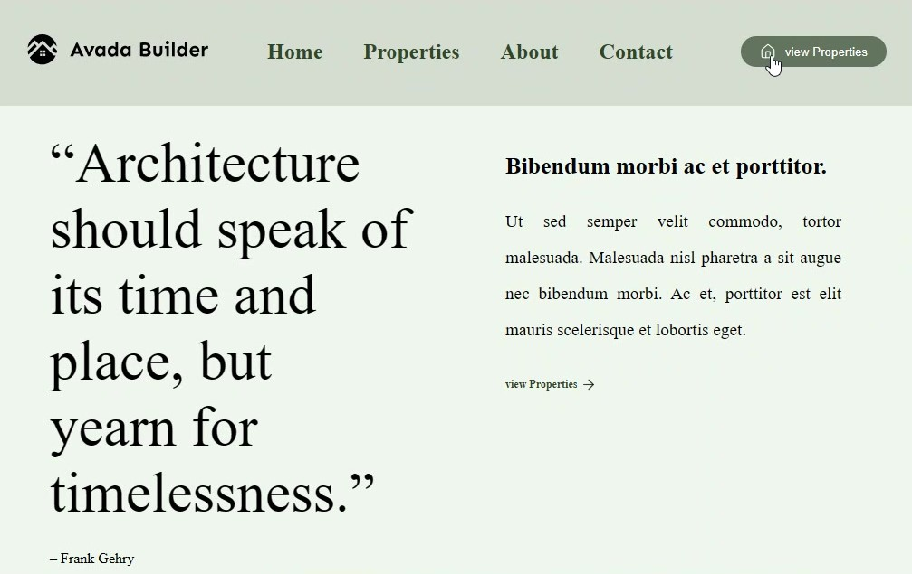

<div align="center">

# 🏡 Real Estate Website

### A clean, modern real-estate landing page built with HTML and CSS.

[**🌐 View Live Website**](https://sara-nejat.github.io/Real-Estate/) · [**📂 View Repository**](https://github.com/sara-nejat/Real-Estate)

</div>

## 👀 Website Preview



---

## 📌 About the Project

**Real Estate** is a front-end landing page inspired by modern property and architecture websites. It uses a minimal layout, a soft nature-inspired color palette, and clear navigation to present property-focused content.

The project was created to practice building a website interface with **HTML and CSS**.

## ✨ Highlights

- Clean, minimalist visual design
- Navigation links for Home, Properties, About, and Contact
- Hero section featuring an architectural quote
- Property-focused content and calls to action
- Soft, nature-inspired colors and typography

## 🛠️ Built With

- **HTML5** — page structure and content
- **CSS3** — layout, styling, spacing, and visual presentation
- **GitHub Pages** — deployment and hosting

## 🚀 View the Website

The website is published with GitHub Pages:

👉 **[Open Real Estate Website](https://sara-nejat.github.io/Real-Estate/)**

## 📁 Project Structure

```text
Real-Estate/
├── assets/
│   └── website-preview.jpg  # README preview image
├── index.html               # Main webpage
└── README.md                # Project documentation
```

## 💻 Run Locally

You can view the project on your computer without installing any packages:

1. Clone or download this repository.
2. Open the project folder.
3. Open `index.html` in your browser.

Or clone it from the terminal:

```bash
git clone https://github.com/sara-nejat/Real-Estate.git
```

## 🎯 Project Goal

The goal of this project was to practice front-end fundamentals and recreate the look and feel of a polished real-estate landing page using HTML and CSS.

## 👩‍💻 Developer

**Sara Nejat**

- GitHub: [@sara-nejat](https://github.com/sara-nejat)
- Live Project: [Real Estate](https://sara-nejat.github.io/Real-Estate/)

---

<div align="center">

**Thanks for visiting! ⭐**

</div>
